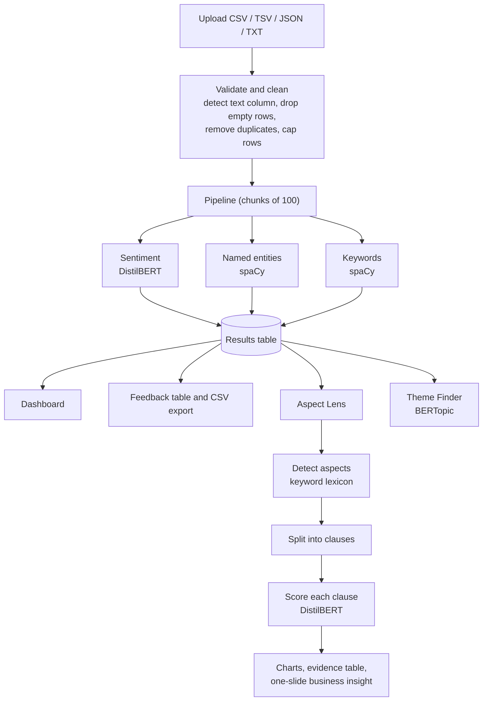

# AspectLens (Review Insight Engine)

**Turn thousands of customer reviews into a clear answer to: *what do customers like, what do they complain about, and what should we fix first?***

[](LICENSE)


Review Insight Engine is an open-source Natural Language Processing (NLP) application that reads customer reviews and support messages and turns them into decisions. It goes beyond a single "positive / negative" label: it finds **which aspects** of a product or service customers talk about (delivery, price, support, app …), scores **how they feel about each one**, shows **why** the model decided what it did, groups reviews into **recurring themes**, and writes a **one-slide business recommendation**.

> *"The mobile app crashes when I try to pay, but support resolved my issue quickly."*
> An ordinary sentiment tool says **negative**. This project says: **app → negative · customer support → positive**.

---

## Table of contents

- [Why this project](#why-this-project)
- [Key features](#key-features)
- [How it works](#how-it-works)
- [Aspect-based sentiment analysis](#aspect-based-sentiment-analysis)
- [Tech stack](#tech-stack)
- [Getting started](#getting-started)
- [Using the app](#using-the-app)
- [Command-line utilities](#command-line-utilities)
- [Evaluating accuracy](#evaluating-accuracy)
- [Project structure](#project-structure)
- [Configuration and customization](#configuration-and-customization)
- [Testing](#testing)
- [Troubleshooting](#troubleshooting)
- [Limitations](#limitations)
- [Roadmap](#roadmap)
- [Team](#team)
- [License](#license)

---

## Why this project

A business with thousands of reviews cannot read them all, and a single overall score hides the useful part. Take:

> *"The product quality is excellent, but delivery was late."*

| Aspect | Sentiment | Action |
|---|---|---|
| Product quality | Positive | Keep it up |
| Delivery | Negative | Fix the courier problem |

Aspect-level analysis tells a team **what to protect and what to fix**. This project makes that analysis explainable, measurable and runnable on an ordinary laptop, without paid APIs.

---

## Key features

| Feature | What you get |
|---|---|
| **Flexible upload** | CSV, TSV, JSON or TXT. The review column is detected automatically (or chosen by hand). |
| **Data-quality controls** | Data check report, duplicate removal, row cap, and a visible count of everything excluded. Nothing is silently dropped. |
| **Overall sentiment** | DistilBERT (fine-tuned on SST-2) with a confidence score for every review. |
| **Aspect-based sentiment** | 12 business aspects detected, each scored from the clause that mentions it, with the evidence phrase shown. |
| **"Why this prediction?"** | Word-level explanation: words are shaded **green** (push toward positive) or **red** (push toward negative). |
| **Clause breakdown** | Mixed sentences are split at *but / however / although …* and each part is scored separately. |
| **Entities and keywords** | spaCy named entities and keywords for every review. |
| **Topic discovery** | BERTopic groups reviews into themes without labels, with keywords and example reviews. |
| **One-slide business insight** | Auto-generated slide: best aspect, biggest pain point, an evidence quote and a recommended next step. Download as HTML. |
| **Built-in evaluation** | Download a labelling template, label it by hand, upload it, and get accuracy, precision, recall, F1 and a confusion matrix. |
| **Exports** | Enriched reviews, aspect results and the insight slide. |
| **Runs locally** | No external API. Your reviews never leave your machine. |

---

## How it works



The app has six tabs: **Dashboard**, **Review Explorer**, **Aspect Lens**, **Try a Sentence**, **Theme Finder** and **How It Works**.

---

## Aspect-based sentiment analysis

Instead of training a new model, the project reuses the existing sentiment model and adds simple, transparent logic around it:

1. **Detect aspects** with a keyword lexicon (whole-word matching, longest phrase first).
2. **Split each review into clauses** at sentence ends and contrast words (*but, however, although, though, whereas, yet*). A clause that mixes different aspects is split further at commas, "and" or "while".
3. **Score each clause** with the sentiment model, so an aspect is judged only by the words around it.
4. **Report one row per (review, aspect)** with the evidence clause, sentiment and confidence. The model has two classes, so predictions below **65 % confidence** are reported as *neutral* (a heuristic, not a trained class).

**Example**

| Review | Aspect | Evidence clause | Sentiment |
|---|---|---|---|
| *The mobile app crashes when I try to pay, but support resolved my issue quickly.* | app / website | The mobile app crashes when I try to pay | Negative |
| | customer support | support resolved my issue quickly | Positive |

**Built-in aspects** (editable in [`src/aspects.py`](src/aspects.py)):

| Aspect | Example keywords |
|---|---|
| delivery | delivery, shipping, arrived, packaging, courier, delay |
| price | price, cost, expensive, cheap, value for money, worth |
| product quality | quality, durability, sturdy, defective, damaged, broken |
| battery | battery, battery life, charging, charger |
| screen | screen, display, resolution, brightness |
| sound | sound, speaker, volume, audio |
| customer support | customer support, customer service, agent, helpline, complaint |
| staff | staff, employee, manager |
| app / website | mobile app, app, website, login, checkout, payment |
| refund / return | refund, return, replacement, exchange, money back |
| process | process, procedure, waiting time, queue |
| ease of use | easy to use, user-friendly, setup |

---

## Tech stack

| Area | Technology | Role |
|---|---|---|
| Language | Python 3.10+ | Everything |
| Interface | [Streamlit](https://streamlit.io) | Web app |
| Charts | [Plotly](https://plotly.com/python/) | Interactive charts |
| Data | [pandas](https://pandas.pydata.org) | Tables and aggregation |
| Sentiment | [DistilBERT SST-2](https://huggingface.co/distilbert/distilbert-base-uncased-finetuned-sst-2-english) via [Transformers](https://huggingface.co/docs/transformers) + [PyTorch](https://pytorch.org) | Positive/negative + confidence |
| Entities, keywords | [spaCy](https://spacy.io) `en_core_web_sm` | Named entities, lemmas, stop words |
| Topics | [BERTopic](https://maartengr.github.io/BERTopic/), [sentence-transformers](https://www.sbert.net) `all-MiniLM-L6-v2`, [UMAP](https://umap-learn.readthedocs.io), [HDBSCAN](https://hdbscan.readthedocs.io) | Theme discovery |
| Metrics | [scikit-learn](https://scikit-learn.org) | Accuracy, precision, recall, F1, confusion matrix |
| Tests | [pytest](https://pytest.org) | Automatic checks |

---

## Getting started

### Prerequisites

- Python **3.10 or newer** (developed and tested on Windows with Python 3.13)
- About **2 GB** of free disk space and an internet connection for the first run (models are downloaded once and cached)
- A GPU is optional; the app uses one automatically if available

### Installation

```bash
# 1. Get the code
git clone https://github.com/addyji007-bot/review_insight_engine.git
cd review_insight_engine

# 2. Create and activate a virtual environment
python -m venv venv
# Windows (PowerShell):   venv\Scripts\Activate.ps1
# macOS / Linux:          source venv/bin/activate

# 3. Install dependencies
pip install -r requirements.txt

# 4. Install the spaCy English model
python -m spacy download en_core_web_sm

# 5. (Optional) Enable Theme Finder
pip install -r requirements-topics.txt
```

### Run

```bash
python -m streamlit run app.py
```

Open **http://localhost:8501**.

> **Tip:** run one full analysis (and one topic discovery) once with internet access so all models are downloaded and cached. Later runs work offline.

---

## Using the app

1. **Dashboard →** upload a file of reviews, or click **Use the sample reviews**.
2. Check the **Data check** box (rows found, empty rows removed, detected text column).
   If the app asks for a column, choose the **full review text**, not the short title.
3. Keep **Remove duplicate reviews** on and set **Maximum reviews to analyze**, then click **Run analysis**.
4. Explore the tabs:

   | Tab | Use it to |
   |---|---|
   | **Dashboard** | See the dashboard: % negative, % positive, confidence, processing speed |
   | **Review Explorer** | Search and filter every review with sentiment, entities, aspects and keywords; download the CSV |
   | **Aspect Lens** | Click **Find aspects** for charts, evidence table, the one-slide insight and evaluation |
   | **Try a Sentence** | Type any sentence to see predicted sentiment, green/red word influence, clause breakdown and tags |
   | **Theme Finder** | Click **Find themes** to find recurring themes |
   | **How It Works** | Read how each part works and its limitations |

### Input format

Any file with a column of review text. These column names are detected automatically (case-insensitive): `text`, `review text`, `review_text`, `review body`, `review content`, `customer review`, `review`, `comment`, `feedback`, `content`, `message`, `body`, `description`.

### Recommended size (on a laptop CPU)

| Reviews | Suitable for |
|---|---|
| 300 – 500 | Live demo (about one to two minutes) |
| 1,000 | Comfortable maximum for a demo |
| 2,000 | Practical limit on a CPU |
| More than 2,000 | Run ahead of time rather than live |

The Dashboard tab reports the real processing speed on your machine.

---

## Command-line utilities

**Create a clean sample from a large dataset** (removes empty, duplicate and very short reviews, then samples):

```bash
python scripts/prepare_sample.py path/to/reviews.csv --n 1000 --out data/sample/reviews_1000.csv
```

Options: `--column "<name>"` to force the review column, `--min-words 6`, `--seed 42`.

**Run the pipeline without the web interface:**

```bash
python -m scripts.run_batch
```

See the header of the script for its options.

---

## Evaluating accuracy

Model quality should be **measured**, not assumed. The Aspect Lens tab includes a validation workflow:

1. Open **Validate against your own labels** and download the 40-row template.
2. Fill the `true_sentiment` column by hand (`positive`, `negative` or `neutral`) based on the clause and aspect shown. Hide the model's prediction column while labelling to avoid bias.
3. Upload the file. The app reports **accuracy, precision, recall, F1** per class, **macro F1**, and a **confusion matrix**.

Always report the **sample size** next to the result: with 40 labels and about 80 % accuracy, the 95 % uncertainty is roughly ±12 percentage points. A larger labelled set gives a tighter estimate.

---

## Project structure

```text
.
├── app.py                      # Streamlit application (6 tabs)
├── requirements.txt            # Core dependencies
├── requirements-topics.txt     # Optional: topic discovery stack
├── LICENSE
├── README.md
├── src/
│   ├── preprocessing.py        # Load files, detect text column, clean text, assign IDs
│   ├── sentiment.py            # DistilBERT wrapper (length-sorted batching)
│   ├── entities.py             # spaCy entities and keywords
│   ├── pipeline.py             # Runs sentiment + entities + keywords together
│   ├── aspects.py              # Aspect keyword lexicon and matcher
│   ├── aspect_sentiment.py     # Clause splitting, per-aspect scoring, metrics
│   ├── topic_engine.py         # BERTopic with settings that adapt to dataset size
│   ├── insight_slide.py        # One-slide business insight generator
│   └── evaluation.py           # Evaluation helpers
├── scripts/
│   ├── prepare_sample.py       # Clean, de-duplicate and sample a dataset
│   ├── run_batch.py            # Batch processing
│   ├── prepare_dataset.py      # Dataset preparation
│   └── evaluate.py             # Evaluation script
├── tests/                      # pytest suite
├── data/
│   ├── sample/                 # Small sample data
│   └── validation/             # Hand-labelled aspect data
└── notebooks/                  # Exploration notebook
```

---

## Configuration and customization

| What | Where | How |
|---|---|---|
| Add or change aspects | `src/aspects.py` | Edit the `ASPECT_KEYWORDS` dictionary. Restart the app. |
| "Neutral" confidence threshold | `src/aspect_sentiment.py` | Change `neutral_threshold` (default `0.65`). |
| Minimum mentions to rank an aspect | `src/insight_slide.py` | Change `MIN_MENTIONS` (default `3`). |
| Recommended action per aspect | `src/insight_slide.py` | Edit the `ACTIONS` dictionary. |
| Default row cap | `app.py` | Change the default of **Maximum reviews to analyze**. |
| Sentiment model | `app.py` / `src/pipeline.py` | Pass another Hugging Face model name to `FeedbackInsightsPipeline(...)`. It must use the labels `positive` and `negative`. |

---

## Testing

```bash
python -m pytest tests -q
```

The suite covers preprocessing, topic handling, integration, aspect detection, aspect-based sentiment, metrics and the insight slide. Tests of the aspect logic use a stand-in classifier, so they run in seconds and offline; they check the logic, not the real model's accuracy (see [Evaluating accuracy](#evaluating-accuracy)).

---

## Troubleshooting

| Problem | Likely cause and fix |
|---|---|
| `has no attribute …` right after editing files | Streamlit kept an old cached object. Stop the app, delete `__pycache__` folders, restart, and hard-refresh the browser (Ctrl + Shift + R). |
| `[Errno 22] Invalid argument` | The terminal the app was started from was closed (for example by reloading the editor window). Stop old Python processes and start the app again in a **new** terminal. |
| Theme Finder says BERTopic is not installed | Run `pip install -r requirements-topics.txt`. |
| "Topic discovery needs at least 10 reviews" | The data has too few **unique** reviews. Use a larger, more varied file. |
| Entity column is empty for most reviews | Expected: named entities are people, places, organizations and dates. Use the **Topics mentioned** column for what reviews are about. |
| First analysis is very slow | Models are being downloaded once. Later runs are faster. For large files, lower **Maximum reviews to analyze**. |
| spaCy model not found | `python -m spacy download en_core_web_sm`. |
| Red error box in the app | Open **Technical details** in the box; it shows the full traceback. |

---

## Limitations

- The sentiment model is **two-class** and was trained on **movie reviews**, so results on product or support text are indicative, not guaranteed. Measure accuracy on your own data.
- Aspect detection is **keyword-based**: words outside the lexicon are missed, and a keyword can match in an unrelated sense.
- **Sarcasm** and negation that spans clauses can be misread.
- Two aspects joined without a comma, "and" or contrast word share one score.
- **Neutral** is a confidence rule, not a trained class.
- Topic results on small or highly repetitive data are only exploratory.
- English only.
- The word-influence explanation removes one word at a time, so it can miss words that work together.

---

## Roadmap

- Fine-tune a three-class or dedicated ABSA model on labelled product-review data.
- Learn aspects automatically (for example from topics) instead of a fixed list.
- Larger labelled evaluation set with two annotators and agreement reporting.
- Additional explanation methods (LIME, SHAP).
- Multilingual support and live data connectors (support tickets, email).

---

**Research and models**

- Sanh et al., *DistilBERT, a distilled version of BERT: smaller, faster, cheaper and lighter* ([arXiv:1910.01108](https://arxiv.org/abs/1910.01108)).
- Socher et al., *Recursive Deep Models for Semantic Compositionality Over a Sentiment Treebank* (SST-2), EMNLP 2013.
- Grootendorst, *BERTopic: Neural topic modeling with a class-based TF-IDF procedure* ([arXiv:2203.05794](https://arxiv.org/abs/2203.05794)).
- Reimers and Gurevych, *Sentence-BERT* ([arXiv:1908.10084](https://arxiv.org/abs/1908.10084)).
- McInnes et al., *UMAP* ([arXiv:1802.03426](https://arxiv.org/abs/1802.03426)).

---

## Author 

 Aditya Gupta

---

## License

This project is released under the **MIT License**; see [LICENSE](LICENSE).

The base project listed above remains subject to its own licence terms. Please refer to that repository for details.
